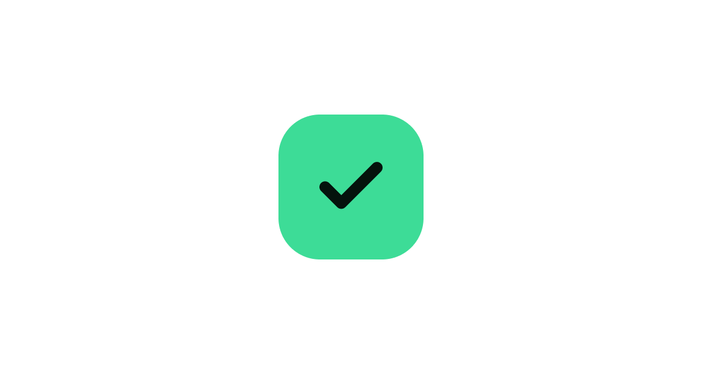
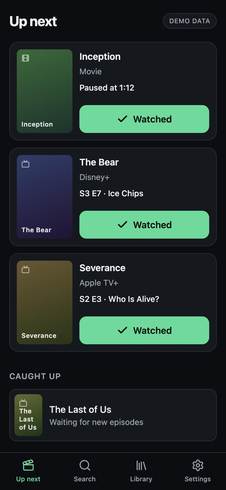
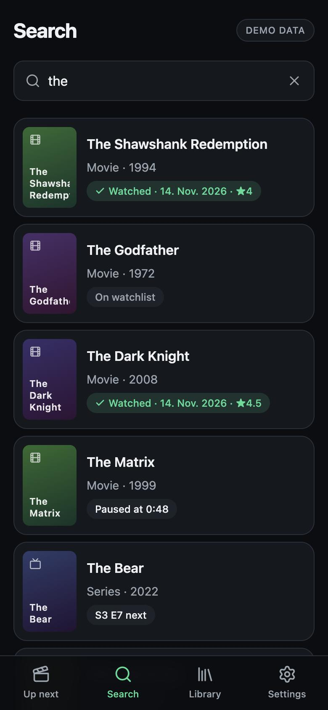
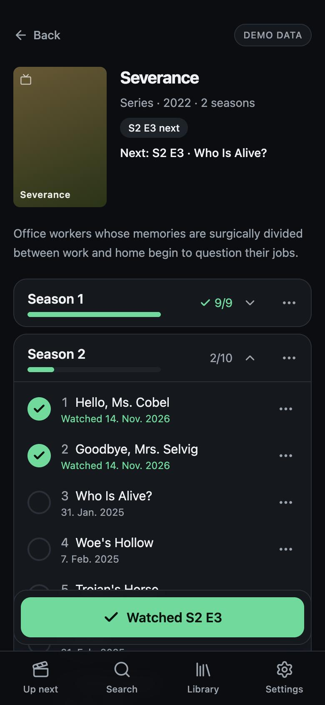
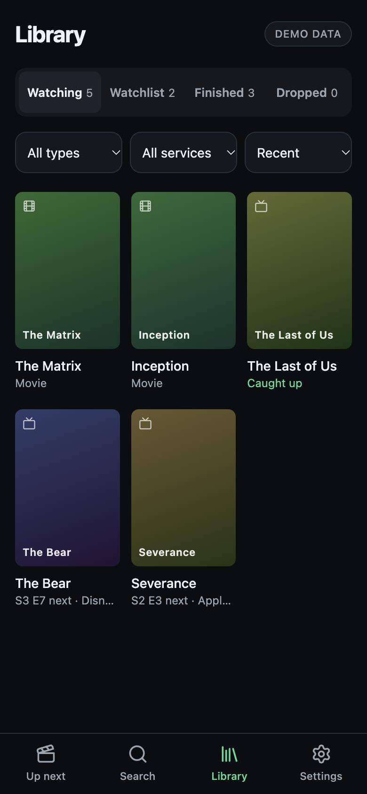
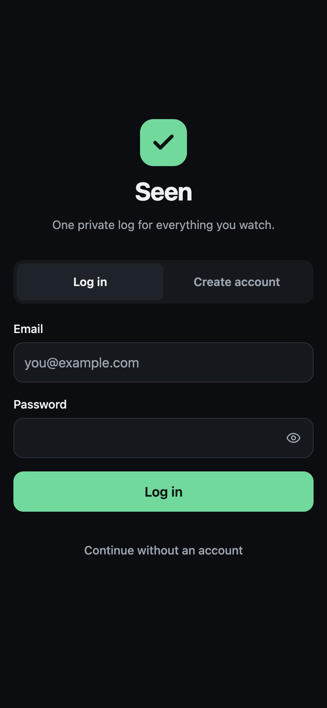

<p align="center">
  
</p>

# Seen

A private, local-first tracker for movies and series, across every streaming service.
Mobile-first React app, installable as a PWA. Built as a design-school project (Designlab, Session 01).

> *Have I seen this? Where did I stop? What did I think of it?*

**Status:** frontend MVP. Watch data lives in your browser (IndexedDB), title metadata comes from a
bundled demo catalogue, and optional email + password accounts run on Supabase Auth. Cloud sync and
live TMDB data are the next steps.

## Screenshots

<p align="center">
  
  
  
  
  
</p>

<p align="center"><sub>Up next · Search · Series detail · Library · Log in (demo data)</sub></p>

## Features

- **Search and "Seen it?" check:** every result shows your status (`Watched · 12 Mar 2026 · ★4`, `Paused at 1:12`, `S2 E5 next`, `On watchlist`).
- **Up next:** in-progress series and paused movies, with a one-tap **✓ Watched** and a 5-second undo.
- **Series progress:** season accordion, mark a whole season, "Watched up to here", and a duplicate guard that offers *Log rewatch*.
- **Movies:** watch history, rewatches, and a "Stopped at" timestamp to resume from.
- **Ratings:** half stars plus a one-line note, with one dismissible inline prompt when you finish a title.
- **Library:** Watching, Watchlist, Finished and Dropped tabs, with filters and sorting.
- **Your data is yours:** Export and Import as JSON (merged without duplicates), and a full reset.
- **Accessible and themed:** dark and light themes, 44 px tap targets, visible focus, reduced-motion support.

## Tech stack

React 19, Vite, TypeScript (strict), Tailwind CSS v4, React Router, Dexie (IndexedDB) with live queries,
Supabase Auth, vite-plugin-pwa, Vitest.

## Setup

Requires Node 20+.

```bash
npm install
npm run dev
```

Open the URL Vite prints. It also listens on your LAN, so you can open
`http://<your-computer-ip>:5173` on a phone on the same Wi-Fi.
Nothing is required to run it. Accounts are optional (see below).

| Script | What it does |
| --- | --- |
| `npm run dev` | Dev server (LAN-accessible) |
| `npm run build` | Typecheck (`tsc --noEmit`) + production build |
| `npm run preview` | Serve the production build (service worker + install prompt work here) |
| `npm run lint` | ESLint |
| `npm run test` | Vitest (pure logic + Dexie integration via fake-indexeddb) |
| `npm run icons` | Regenerate PWA icons from `public/icon.svg` |

## Accounts (Supabase Auth)

Email + password sign-up and login use Supabase Auth (`/login`, and Settings → Account). Accounts are
optional: without them the app runs fully local, as before.

1. Copy `.env.example` to `.env.local` and set `VITE_SUPABASE_URL` and `VITE_SUPABASE_ANON_KEY`
   (the publishable `sb_publishable_…` or legacy anon key from Supabase dashboard → Project Settings → API Keys).
   Never put a `service_role` key in the frontend. Restart `npm run dev` after editing.
2. In the dashboard under Authentication → URL Configuration, add `http://localhost:5173` (and your
   phone/LAN or deployed URL) to the allowed redirect URLs. With email confirmation enabled (the default),
   new users must click the emailed link before they can log in.

Signing in doesn't sync data yet: your log still lives in this browser's IndexedDB. Cloud sync is the next step.

## Demo data ("mock mode")

Until the backend exists, all metadata comes from `src/lib/mock/`: **15 movies and 8 series**
with real TMDB IDs and real season/episode structure (Breaking Bad, Stranger Things, The Bear,
Severance, The Last of Us, Succession, Fleabag, Chernobyl). A "Demo data" badge is shown while
this source is active.

Known simplifications in the demo catalogue:
- Posters are generated gradients (no bundled artwork).
- Air dates for weekly shows are approximated; The Bear S4 and Fleabag use "Episode N" titles.
- "Available on" provider suggestions are illustrative, not live data.

## Trying the main flow

1. **Search** → "Breaking Bad" → open it.
2. In Season 1, open the **⋯** menu on episode 4 → **Watched up to here** (or long-press the row).
3. **Up next** now shows *S1 E5 · Gray Matter*. Tap **✓ Watched** → *S1 E6* is next. Undo is in the toast for 5 s.
4. Tap an already-watched episode → the **duplicate guard** offers *Log rewatch* / *Cancel*.
5. Search again: the result shows your status badge instantly.
6. **Settings** → Export JSON → Reset all data → Import JSON restores the exact state.

## Architecture

```
src/
  routes/        Up next, Search, Library, Settings, Title detail
  components/    UI building blocks (toast with undo, season accordion, duplicate guard, ratings…)
  lib/
    types.ts db.ts actions.ts   data model, Dexie schema, all mutations (each returns an undo)
    logic/                      pure, unit-tested business logic (next episode, status transitions,
                                badges, library filters, import merge, time parsing, providers)
    supabase.ts authContext.ts  Supabase client (null without env vars) and auth state
    metadata/                   MetadataSource interface, mock implementation, IndexedDB cache
    mock/                       bundled demo catalogue
```

- **Local-first:** Dexie (IndexedDB) with live queries (`dexie-react-hooks`).
- **Sync-ready:** every record has a stable `id` and `updatedAt`. Import merges by id (newest
  `updatedAt` wins) and de-duplicates episode watches by title/season/episode.
- **One swap point for metadata:** `src/lib/metadata/index.ts`.

### Supabase + TMDB (next)

The TMDB read token must never ship in the browser bundle. Plan: a Supabase Edge Function proxies
TMDB (search, details, season episodes, watch providers for the user's region) and becomes a second
`MetadataSource` implementation; the cache and UI stay unchanged. To prepare, create a free TMDB
account → Settings → API → request a key and copy the **API Read Access Token (v4)**; it will be
stored as a Supabase function secret, not in this repo. Optional sync/accounts can then be added
on top of the stable IDs and `updatedAt` fields (deletions will need tombstones at that point).

## Product assumptions (fixed for v1)

1. **Cross-service is the core value.** One log for everything; native "Continue watching" rows only cover one service.
2. **No automatic tracking.** Services don't share viewing data, so logging is manual and must take ≤ 1 tap / < 5 s for the next episode.
3. **Ratings are optional and never nag.** One dismissible inline prompt when a title is finished; no per-episode reviews, no modals.
4. **Your data is yours.** Local-first storage, no account, one-tap export/import.
5. **Lean by design.** No database to run in v1. Monetization (out of scope) would be a one-time "Pro" unlock and/or where-to-watch affiliate links, never limits on core tracking.

## Accessibility

Semantic HTML, visible focus rings, ≥ 44 px tap targets, AA-contrast tokens in both themes,
`prefers-reduced-motion` respected, keyboard-operable star rating (arrow keys, half steps).

## Attribution

This product uses the TMDB API but is not endorsed or certified by [TMDB](https://www.themoviedb.org).
Title IDs and metadata structure follow TMDB.
